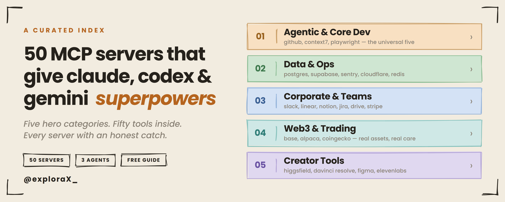

# 50 essential MCP servers for claude, gemini and codex

the model context protocol started life as a niche anthropic spec in late 2024. eighteen months later it's the standard plug every serious AI agent speaks — claude code, gemini cli, codex, cursor, windsurf, all of them. the pitch is boringly simple: instead of every model writing a custom integration for every tool, each model speaks MCP once and every tool that speaks it back becomes available. anthropic calls it a usb-c port for AI. that's the right mental model.

the catalog is now enormous. over 20,000 servers sit on public registries and the sdk was pulling ~97 million downloads a month by march 2026. most of them are junk — abandoned weekend projects, half-finished experiments, or worse. a recent audit found security issues in roughly two-thirds of the popular ones. so before anything else, three rules that matter more than this whole list.

## the three rules

1. **don't install 50.** more than 5-7 connected servers and your agent starts choking on tool bloat — it gets slower and dumber. pick the 3-5 that match what you actually do. this is a menu, not a shopping spree.
2. **treat every server like a cli from a stranger's github.** pin versions. scope tokens to read-only until you've watched how the agent uses them. prefer vendor-official over random forks.
3. **never enable writes against production from an agent loop.** point at a read replica or a snapshot.

## install syntax primer

the three big agents each have their own config path but the underlying json is basically identical:

- **claude code** → `claude mcp add <name> ...` (or `--transport http` for hosted servers)
- **codex** → `codex mcp add <name> -- <command>`, or edit `~/.codex/config.toml`
- **gemini cli** → edit `~/.gemini/settings.json`, same `mcpServers` block

where a server is hosted (an https url) it usually works in all three with the http transport and a browser oauth flow. where it's local (npx/uvx) you drop the same command block into each agent's config. the entries below give the claude command for each and note when codex/gemini differ.

one honesty note: this space moves weekly. exact install strings are given where they could be confirmed against official docs, and for a few servers — mostly the smaller web3/fintech ones — the entry points you to the vendor's docs instead of a command, because a verified source beats a url that isn't 100% sure. always sanity-check the endpoint against the official repo before you paste in a token.

## contents

| # | category | what it covers |
|---|---|---|
| 01 | [core dev — the universal core](servers/01-core-dev.md) | github, context7, playwright, filesystem, brave search |
| 02 | [databases & backend](servers/02-data-backend.md) | postgres, supabase, neon, sqlite, redis |
| 03 | [ops, infra & cloud](servers/03-ops-infra.md) | cloudflare, vercel, aws, docker hub, sentry, kubernetes |
| 04 | [corporate / team & productivity](servers/04-corporate-productivity.md) | slack, linear, notion, jira/confluence, gdrive, gmail, calendar, asana, airtable |
| 05 | [payments & fintech](servers/05-fintech.md) | stripe, paypal, plaid, quickbooks |
| 06 | [blockchain & web3](servers/06-web3.md) | base, solana agent kit, thirdweb, the graph, dune, etherscan |
| 07 | [trading & markets](servers/07-trading.md) | alpaca, ccxt, polygon.io, coingecko, tradingview |
| 08 | [creator tools — media & design](servers/08-creator-tools.md) | higgsfield, davinci resolve, figma, elevenlabs, blender, canva, ableton, youtube |
| 09 | [the reasoning & memory layer](servers/09-reasoning-memory.md) | sequential thinking, memory |

## all 50 servers at a glance

| # | server | category | official / community | hosted / local | money or irreversible? |
|---|---|---|---|---|---|
| 1 | github | core-dev | official | hosted | no |
| 2 | context7 | core-dev | official | hosted / local | no |
| 3 | playwright | core-dev | official | local | no |
| 4 | filesystem | core-dev | official | local | no |
| 5 | brave search | core-dev | official | local | no |
| 6 | postgres | data / backend | official (archived) | local | yes |
| 7 | supabase | data / backend | official | hosted | yes |
| 8 | neon | data / backend | official | hosted | yes |
| 9 | sqlite | data / backend | community | local | no |
| 10 | redis | data / backend | official | local | no |
| 11 | cloudflare | ops / infra | official | hosted | yes |
| 12 | vercel | ops / infra | official | hosted | yes |
| 13 | aws | ops / infra | official | local | yes |
| 14 | docker hub | ops / infra | community | local | no |
| 15 | sentry | ops / infra | official | hosted | no |
| 16 | kubernetes | ops / infra | community | local | yes |
| 17 | slack | productivity | community | local | yes |
| 18 | linear | productivity | official | hosted | no |
| 19 | notion | productivity | official | hosted | no |
| 20 | jira / confluence | productivity | official | hosted | no |
| 21 | google drive | productivity | official (archived) | local | no |
| 22 | gmail | productivity | community | local | yes |
| 23 | google calendar | productivity | community | local | yes |
| 24 | asana | productivity | official | hosted | no |
| 25 | airtable | productivity | community | local | no |
| 26 | stripe | fintech | official | hosted / local | yes |
| 27 | paypal | fintech | official | hosted | yes |
| 28 | plaid | fintech | official | hosted | yes |
| 29 | quickbooks | fintech | community | hosted | yes |
| 30 | base | web3 | official | hosted | yes |
| 31 | solana agent kit | web3 | community | local | yes |
| 32 | thirdweb | web3 | official | local | yes |
| 33 | the graph | web3 | community | local | no |
| 34 | dune | web3 | community | local | no |
| 35 | etherscan | web3 | community | local | no |
| 36 | alpaca | trading | official | local | yes |
| 37 | ccxt | trading | community | local | yes |
| 38 | polygon.io | trading | official | local | no |
| 39 | coingecko | trading | official | hosted | no |
| 40 | tradingview | trading | community | local | no |
| 41 | higgsfield | creator | official | hosted | no |
| 42 | davinci resolve | creator | community | local | no |
| 43 | figma | creator | official | hosted / local | no |
| 44 | elevenlabs | creator | official | local | no |
| 45 | blender | creator | community | local | no |
| 46 | canva | creator | official | hosted | no |
| 47 | ableton live | creator | community | local | no |
| 48 | youtube | creator | community | local | no |
| 49 | sequential thinking | reasoning | official | local | no |
| 50 | memory | reasoning | official | local | no |

> the **money or irreversible?** column flags servers that — per the source article's warnings — can move real money, handle banking/financial data, place real trades, execute irreversible on-chain transactions, or write to production infrastructure/databases. it is a prompt to slow down and keep a human in the loop, not a claim that the server is unsafe. read each server's gotcha for the specifics.

## how to actually choose

if you build software: github, context7, playwright, your database (postgres/supabase/neon), sentry. five servers, 90% of the value.

if you ship content: higgsfield, davinci resolve, elevenlabs, youtube, figma. that's a full creator pipeline.

if you trade or work onchain: start read-only — coingecko, polygon, the graph, dune. add base mcp or alpaca only when you understand the confirmation flow cold, and paper-trade first.

if you run a company on docs and tickets: slack, linear/jira, notion, google drive. the agent stops being a chat window and starts being a teammate.

the trap is installing everything because it sounds useful. don't. each connected server eats context and drags performance on the work you actually care about. three to five sharp picks beat twenty dull ones every time. revisit the config quarterly — the ecosystem moves fast, and a server you set up before march 2026 has probably been superseded by something faster and better-authed.

pick your five. wire them in. ship.

---

source article: [@exploraX_ on X](https://x.com/exploraX_/status/2062448236439155173?s=20)

*curated by [@exploraX_](https://x.com/exploraX_)*
